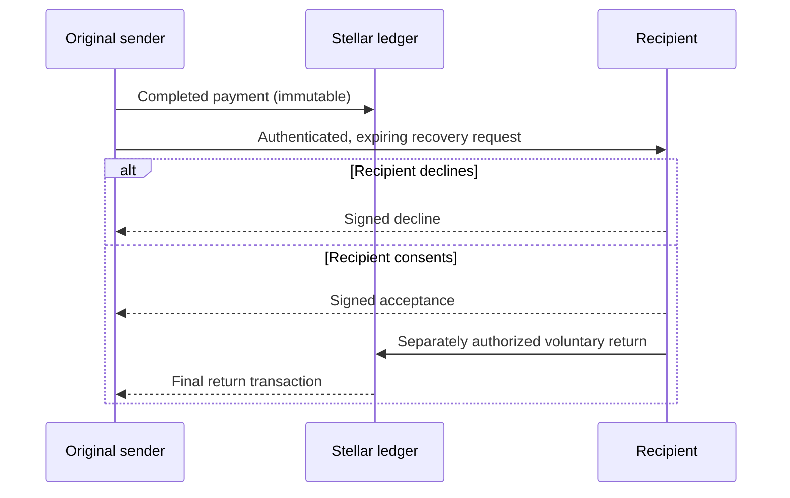

# Stellar Reclaim — V1 protocol boundary

Status: **specification plus read-only ledger and normalization foundation**. Signed requests, wallets, backend, consent, notifications, and refund settlement are not built by Issues #1–#4. Never imply a payment can be reversed.

## Actors and proof

- Sender: payer of an executed Stellar operation, proven by the operation's ledger source (not the transaction fee payer). A future signed request must bind network passphrase, transaction hash, operation index, asset identifier, destination and expiry. A transaction submitter signature by itself is not a sufficient current request signature.
- Recipient: receiving account on a finalized operation. A future wallet inbox must verify that its signer controls the corresponding recipient account before disclosing nonpublic requests. Contract or exchange recipients are unsupported until the corresponding custody operator opts in.
- Wallet integrator: untrusted presentation layer; the user must separately authorize the return payment. Recipient acceptance never creates a blockchain reversal.
- Observer: may read public ledger facts; must not infer private recipient messages from public tx information.

## Supported lookup (milestone #1–#4)

User explicitly chooses `testnet` or `public`. Horizon root passphrase is verified; the client reads a finalized successful transaction and its operation list. Operation index is zero-based and preserves identity. `payment`, `path_payment_strict_receive` and `path_payment_strict_send` are normalized with source/destination, XLM or exact issuer-qualified credit asset, exact 7-decimal amounts and optional distinct source asset/amount for path payments. Unsupported/malformed types fail closed; `invoke_host_function` is not treated as a payment. Classic G and muxed M address identities are retained and checked against their base account and muxed identifier.

## Future state sequence (not yet implemented)

A recovery request is neither an enforceable debt nor an automatic transfer. A partial or missing refund is not a completed recovery. Signing/consent/settlement must be built in later PRs.

## Unsupported cases

Unconfirmed or failed transactions; arbitrary contract token events; operations without an attributable source, destination or exact issuer; contract account signing and hosted exchange refunds; unsupported non-account recipient types; ambiguous multiple operations without an operation index. Horizon data is not a standalone signer-identity proof.

## Demonstration / validation

`node --experimental-strip-types packages/core/src/cli.ts --amount 12.3456789` yields an exact integer stroop representation. Unit tests use mock Horizon responses and do **not** certify live testnet execution.
